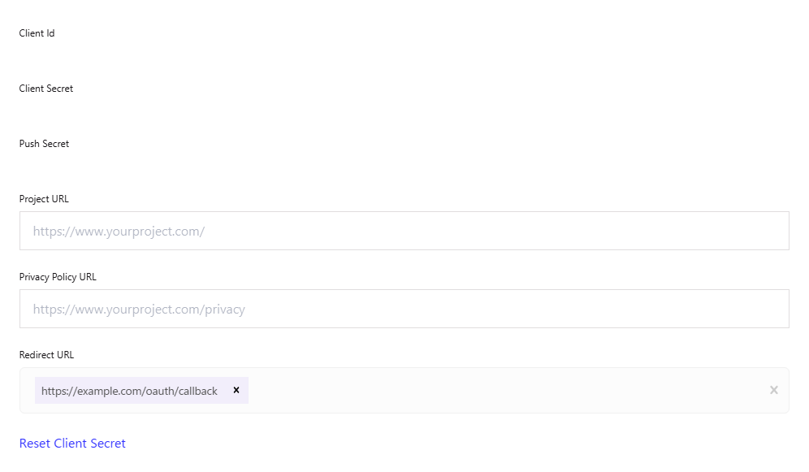
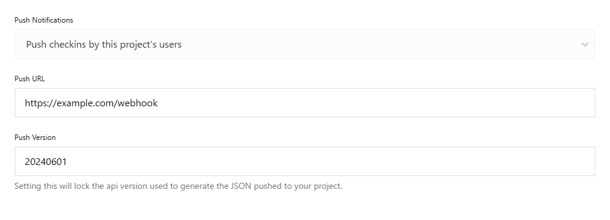

[English](README.md) | [日本語](README.ja.md)

# Swarm Linker

[](../../actions)

SwarmでのチェックインをX(Twitter)に投稿するアプリケーション。

## 概要

Swarmでのチェックイン情報を取得し、X(Twitter)に投稿します。  
投稿されるテキストは以下の通りです。コメントや画像は投稿されません。

```
I'm at [場所名] in [住所]
[共有URL]
```

## APIエンドポイント

- `GET /oauth` - アクセストークンを取得するための認可(認証)を開始します。
- `GET /oauth/callback` - 認証後にFoursquareからリダイレクトされ、アクセストークンを取得します。
- `POST /webhook` - Swarmでのチェックイン通知を受け取り、X(Twitter)に投稿します。
- `GET /{ENDPOINT_ACCESS_TOKEN}/tweet` - キャッシュされたチェックイン情報を使用し、X(Twitter)の投稿画面を開きます。
- `GET /{ENDPOINT_ACCESS_TOKEN}/tweet/latest` - 最新のチェックイン情報を取得して使用し、X(Twitter)の投稿画面を開きます。

## 動作環境

- Cloudflare Workers
- [Node.js](https://nodejs.org/)

## 依存関係

- Cloudflare WorkersのNode.js互換
  - [node:crypto](https://developers.cloudflare.com/workers/runtime-apis/nodejs/crypto/)
- [oauth-1.0a](https://github.com/ddo/oauth-1.0a)

## セットアップ

### 0. 事前準備

以下のコマンドを実行し、Cloudflareにログインします。

```sh
npx wrangler login
```

### 1. Wranglerファイルの設定

`wrangler.jsonc` ファイルを環境に合わせて設定します。

#### KVの設定

本アプリケーションでは、チェックイン情報をキャッシュするため、KVを使用します。  
以下のコマンドを実行し、KVネームスペースを作成します。

```sh
npx wrangler kv namespace create KV
```

`wrangler.jsonc` ファイルの `kv_namespaces` 内にある `id` を、表示されたIDに変更します。

```json
"kv_namespaces": [
  {
    "binding": "KV",
    "id": "d99a1e428eb042f6ad2adfe5b1829c9e"
  }
],
```

### 2. デプロイ

以下のコマンドを実行し、Cloudflareにデプロイします。

```sh
npx wrangler deploy
```

表示されたURL `https://***.workers.dev` がAPIのベースURLとなります。

### 3. Secretsの設定

> [!TIP]
> ローカルで動作させる場合、Secretsの代わりに `.env` ファイルを使用します。  
> `.env.example` ファイルを参考に `.env` ファイルを作成してください。

#### Foursquare関係の設定

Foursquare APIのバージョンを設定します。特に理由がない場合、`20240601` を設定してください。

```sh
npx wrangler secret put FOURSQUARE_API_VERSION
```

[Foursquare Developer Console](https://location.foursquare.com/developer/)から以下の認証情報を取得し、設定します。

```sh
npx wrangler secret put FOURSQUARE_API_KEY
npx wrangler secret put FOURSQUARE_API_KEY_SECRET
npx wrangler secret put FOURSQUARE_PUSH_SECRET
```

`/oauth/callback` にアクセスするURLを設定します。 (例: `https://***.workers.dev/oauth/callback` )

```sh
npx wrangler secret put FOURSQUARE_REDIRECT_URI
```

#### 自動投稿の設定

##### X(Twitter)関係の設定

Swarmでのチェックイン時にX(Twitter)に自動投稿する場合、以下を `true` に設定します。  
自動投稿しない場合、設定する必要はありません。

```sh
npx wrangler secret put AUTO_TWEET_ENABLED
```

[X(Twitter) Developer Console](https://console.x.com/)から以下の認証情報を取得し、設定します。  
自動投稿しない場合、設定する必要はありません。

```sh
npx wrangler secret put TWITTER_API_KEY
npx wrangler secret put TWITTER_API_KEY_SECRET
npx wrangler secret put TWITTER_ACCESS_TOKEN
npx wrangler secret put TWITTER_ACCESS_TOKEN_SECRET
```

#### 手動投稿の設定

手動投稿用のURLに使用するトークンを設定します。推測されにくい文字列を設定してください。  
手動投稿しない場合、設定する必要はありません。

```sh
npx wrangler secret put ENDPOINT_ACCESS_TOKEN
```

例えば、トークンに `1a79a4d60de6718e8e5b326e338ae533` を設定した場合、手動投稿用のURLは以下となります。

- `https://***.workers.dev/1a79a4d60de6718e8e5b326e338ae533/tweet`
- `https://***.workers.dev/1a79a4d60de6718e8e5b326e338ae533/tweet/latest`

### 4. Foursquare Developer Consoleの設定

[Foursquare Developer Console](https://location.foursquare.com/developer/)にアクセスし、以下を設定します。

#### OAuth Authenticationの設定

- `Redirect URL` - `/oauth/callback` にアクセスするURLを設定します。 (例: `https://***.workers.dev/oauth/callback` )



#### Push APIの設定

- `Push Notifications` - `Push checkins by this project's users` を選択します。
- `Push URL` - `/webhook` にアクセスするURLを設定します。 (例: `https://***.workers.dev/webhook` )
- `Push Version` - Push APIのバージョンを設定します。特に理由がない場合、`20240601` を設定してください。



### 5. Foursquareとの認証

ブラウザから `https://***.workers.dev/oauth` にアクセスし、Foursquareと認証します。  
認証後、ブラウザに表示されたアクセストークンをSecretsに設定します。

```sh
npx wrangler secret put FOURSQUARE_ACCESS_TOKEN
```

## 使い方

### 自動投稿

Swarmでチェックインすると、`/webhook` が実行されます。  
自動投稿が有効な場合、APIを用いて自動的にX(Twitter)に投稿されます。

### 手動投稿

ブラウザから以下のURLにアクセスすると、X(Twitter)の投稿画面が開きます。  
URLをブックマークに登録して使用してください。

- `https://***.workers.dev/{ENDPOINT_ACCESS_TOKEN}/tweet`

  キャッシュされたチェックイン情報を使用します。  
  チェックイン情報のキャッシュは、以下のリクエスト時に更新されます。

  - `/webhook`
  - `/{ENDPOINT_ACCESS_TOKEN}/tweet/latest`

- `https://***.workers.dev/{ENDPOINT_ACCESS_TOKEN}/tweet/latest`

  最新のチェックイン情報を取得して使用します。

## ライセンス

このソフトウェアは[Unlicense](LICENSE)に基づいてライセンスされています。

## 関連項目

- https://appl-rot13.hatenablog.jp/entry/2024/07/02/000417
