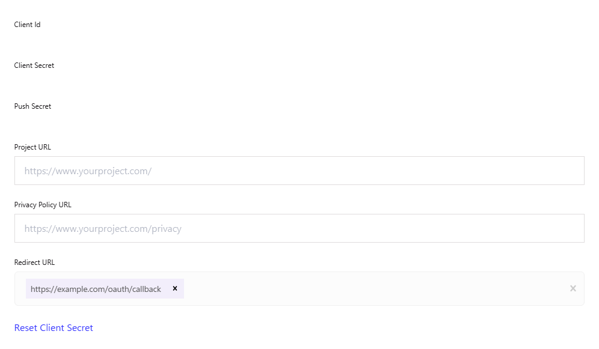
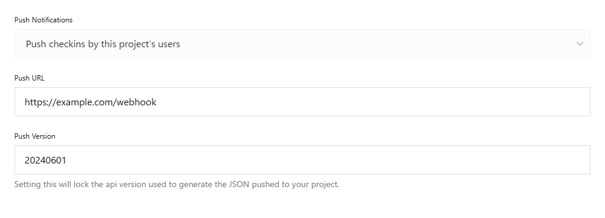

[English](README.md) | [日本語](README.ja.md)

# Swarm Linker

[](../../actions)

An application that posts Swarm check-ins to X (Twitter).

## Overview

The application retrieves Swarm check-ins and posts to X (Twitter).  
The posted text will be as follows. Comments and images will not be included.

```
I'm at [Venue name] in [Venue address]
[Share URL]
```

## API Endpoints

- `GET /oauth` - Initiates authorization to obtain the access token.
- `GET /oauth/callback` - Handles the redirect from Foursquare after authentication to obtain the access token.
- `POST /webhook` - Receives Swarm check-in notifications and posts to X (Twitter).
- `GET /{ENDPOINT_ACCESS_TOKEN}/tweet` - Opens the X (Twitter) post composer using the cached check-in.
- `GET /{ENDPOINT_ACCESS_TOKEN}/tweet/latest` - Retrieves the latest check-in and opens the X (Twitter) post composer.

## Requirements

- Cloudflare Workers
- [Node.js](https://nodejs.org/)

## Dependencies

- Cloudflare Workers Node.js compatibility
  - [node:crypto](https://developers.cloudflare.com/workers/runtime-apis/nodejs/crypto/)
- [oauth-1.0a](https://github.com/ddo/oauth-1.0a)

## Setup

### 0. Preparations

Run the following command to log in to Cloudflare.

```sh
npx wrangler login
```

### 1. Set Up Wrangler File

Set up the `wrangler.jsonc` file to match your environment.

#### KV Settings

This application uses KV to cache check-ins.  
Run the following command to create a new KV namespace.

```sh
npx wrangler kv namespace create KV
```

Update the `id` field under `kv_namespaces` to the generated ID in the `wrangler.jsonc` file.

```json
"kv_namespaces": [
  {
    "binding": "KV",
    "id": "d99a1e428eb042f6ad2adfe5b1829c9e"
  }
],
```

### 2. Deploy

Run the following command to deploy to Cloudflare.

```sh
npx wrangler deploy
```

The displayed URL `https://***.workers.dev` is the API's base URL.

### 3. Set Up Secrets

> [!TIP]
> When running locally, use a `.env` file instead of Secrets.  
> Create a `.env` file based on the `.env.example` file.

#### Foursquare Settings

Set the Foursquare API version. Unless you have a specific reason, set it to `20240601`.

```sh
npx wrangler secret put FOURSQUARE_API_VERSION
```

Obtain and set the following credentials from [Foursquare Developer Console](https://location.foursquare.com/developer/).

```sh
npx wrangler secret put FOURSQUARE_API_KEY
npx wrangler secret put FOURSQUARE_API_KEY_SECRET
npx wrangler secret put FOURSQUARE_PUSH_SECRET
```

Set the URL to access `/oauth/callback` (for example, `https://***.workers.dev/oauth/callback` ).

```sh
npx wrangler secret put FOURSQUARE_REDIRECT_URI
```

#### Automatic Posting Settings

##### X (Twitter) Settings

To automatically post Swarm check-ins to X (Twitter), set the following to `true`.  
This setting is not required if you do not need automatic posting.

```sh
npx wrangler secret put AUTO_TWEET_ENABLED
```

Obtain and set the following credentials from [X (Twitter) Developer Console](https://console.x.com/).  
These settings are not required if you do not need automatic posting.

```sh
npx wrangler secret put TWITTER_API_KEY
npx wrangler secret put TWITTER_API_KEY_SECRET
npx wrangler secret put TWITTER_ACCESS_TOKEN
npx wrangler secret put TWITTER_ACCESS_TOKEN_SECRET
```

##### Manual Posting Settings

Set a token for the manual posting URLs. Use a string that is difficult to guess.  
This setting is not required if you do not need manual posting.

```sh
npx wrangler secret put ENDPOINT_ACCESS_TOKEN
```

For example, if you set the token to `1a79a4d60de6718e8e5b326e338ae533`, the manual posting URLs will be as follows.

- `https://***.workers.dev/1a79a4d60de6718e8e5b326e338ae533/tweet`
- `https://***.workers.dev/1a79a4d60de6718e8e5b326e338ae533/tweet/latest`

### 4. Configure Foursquare Developer Console

Access [Foursquare Developer Console](https://location.foursquare.com/developer/) and configure the following.

#### OAuth Authentication Settings

- `Redirect URL` - Set the URL to access `/oauth/callback` (for example, `https://***.workers.dev/oauth/callback` ).



#### Push API Settings

- `Push Notifications` - Select `Push checkins by this project's users`.
- `Push URL` - Set the URL to access `/webhook` (for example, `https://***.workers.dev/webhook` ).
- `Push Version` - Set the push API version. Unless you have a specific reason, set it to `20240601`.



### 5. Authenticate with Foursquare

Open `https://***.workers.dev/oauth` in your browser and authenticate with Foursquare.  
After authentication, add the access token displayed in the browser to Secrets.

```sh
npx wrangler secret put FOURSQUARE_ACCESS_TOKEN
```

## Usage

### Automatic Posting

When a check-in is made on Swarm, `/webhook` is triggered.  
If automatic posting is enabled, the application automatically posts to X (Twitter) via API.

### Manual Posting

Open one of the following URLs in your browser to open the X (Twitter) post composer.  
Bookmark the URLs for future use.

- `https://***.workers.dev/{ENDPOINT_ACCESS_TOKEN}/tweet`

  Uses the cached check-in.  
  The check-in cache is updated when the following endpoints are requested:

  - `/webhook`
  - `/{ENDPOINT_ACCESS_TOKEN}/tweet/latest`

- `https://***.workers.dev/{ENDPOINT_ACCESS_TOKEN}/tweet/latest`

  Retrieves the latest check-in.

## License

This software is licensed under the [Unlicense](LICENSE).
